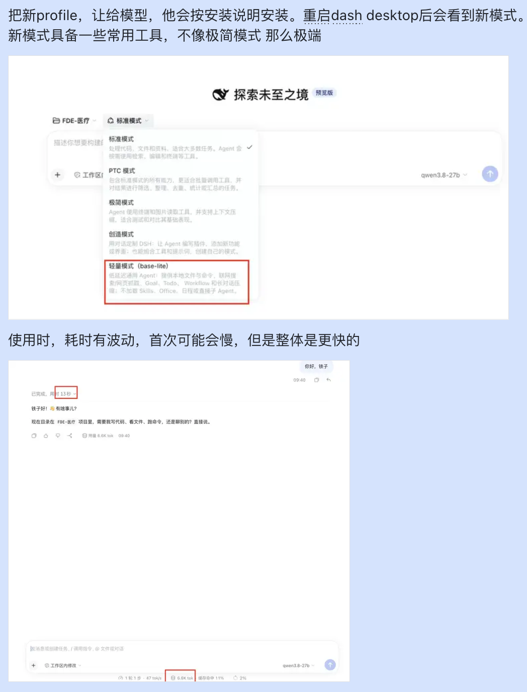

# @novocube/dsh-base-lite

DeepSeek Harness 的低上下文日常模式插件。安装后新增独立的 **轻量模式（base-lite）**，不替换官方内置模式，也不声明模型、Provider 或凭据。



> 截图中的耗时是单次实际样本，不是固定性能承诺。首次请求仍可能受到模型冷启动、Provider 排队和提示缓存未命中影响。base-lite 的稳定收益是缩小普通对话的工具 Schema 与提示上下文。

## 保留能力

- Bash/PowerShell、本地文件读写编辑和搜索
- 后台任务
- 官方联网搜索与网页抓取
- Goal、Todo、Workflow
- 长对话压缩
- 工作区 `AGENTS.md` 指令

默认不加载 Skills catalog、Office/Present、日程、直接子 Agent，以及媒体、科研、法务、报销、情报、质检、IM 等垂直工作台。需要这些能力时，可切换回官方内置模式或专业模式。

## 安装

### DeepSeek Harness Desktop

Desktop profile 由桌面应用管理，请只从 **插件 → 添加插件** 安装；不要对
`--profile desktop` 直接执行 `dsh plugin add/remove`，否则会触发整个 profile 的依赖重算，
并可能把其他插件原有的版本冲突提前暴露出来。

插件尚未发布到 registry 前，请在添加插件页填写 GitHub Release 的 `.tgz` 下载地址或本地
`.tgz` 绝对路径。发布后才可直接输入：

```text
@novocube/dsh-base-lite
```

完成安装并启用后，新建对话，从模式菜单选择 **轻量模式（base-lite）**。若菜单没有立即刷新，请完全退出并重新打开 Desktop。

### GitHub Release 或本地包

插件市场也可以安装预构建 `.tgz` 的下载地址。开发者本地验证：

```sh
npm run validate
npm pack
```

然后在 **插件 → 添加插件** 中填写生成的 `.tgz` 绝对路径或 Release 下载地址。

> `dsh <profile> --patch ./cordis.patch.yml --dump-config` 适合做只读组合验证；它不会安装
> 插件，也不会重算 Desktop profile 的其他依赖。

## 从手工安装版迁移

早期版本通过安装脚本直接修改 `~/.dsh/profiles/desktop/cordis.patch.yml`。安装插件版前，必须先在旧安装包目录执行：

```sh
sh uninstall.sh
```

确认补丁中不再存在 `BEGIN base-lite-desktop-profile` 和 `preset-base-lite`，再安装插件，避免重复 preset ID。

## 生命周期

- 启用插件：注册 `preset-base-lite`。
- 禁用插件：轻量模式不再进入组合配置。
- 升级插件：由插件管理器更新 Bundle。
- 卸载插件：模式随 Bundle 一起移除，不在用户补丁中留下标记区块。
- 未选择轻量模式时：不会为其他模式增加 Agent 工具 Schema。

## 开发

```sh
npm run validate
npm run pack:check
```

兼容范围：DSH `>=0.2.2-rc.5 <0.3.0`。

## 发布与市场收录

1. 发布 `@novocube/dsh-base-lite` 到可访问的 npm registry，或上传 `npm pack` 生成的 `.tgz` 到 GitHub Release。
2. 在插件页面用包名或 `.tgz` URL 验证安装、启用、禁用、升级和卸载。
3. 向 [`awesome-dsh-plugin`](https://github.com/awesome-dsh-plugin/awesome-dsh-plugin) 提交目录条目；目录同步后会进入 DSH Plugin Market。

## 安全边界

本插件是纯配置 Bundle：没有安装脚本、Host JS、客户端注入或网络请求；不读取 API Key、凭据、会话日志或工作区文件。

## 排障

如果安装后 Desktop 报“server stopped unexpectedly”，先从错误详情确认失败的包名。只有错误
明确指向 `@novocube/dsh-base-lite` 时才应归因于本插件；其他插件的 DSH 版本不兼容、重复
Skill provider 或 CommonJS/ESM 加载冲突，需要由对应插件升级或由用户决定停用。本插件不会
自动移除、禁用或放宽其他插件的版本安全检查。
